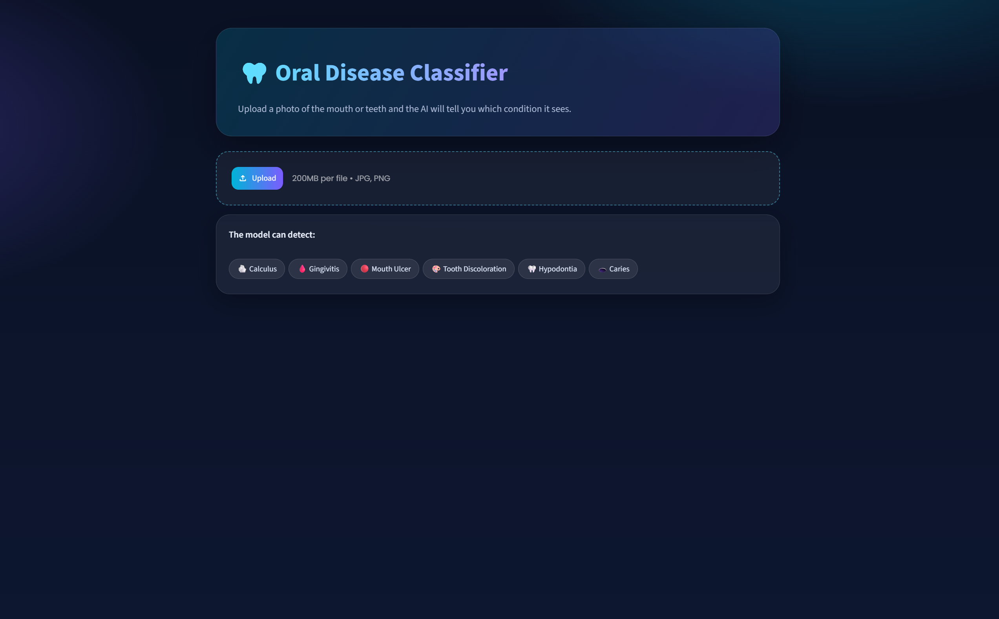
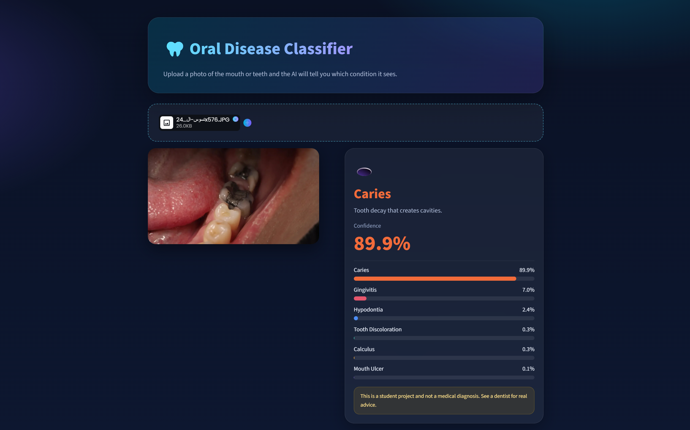
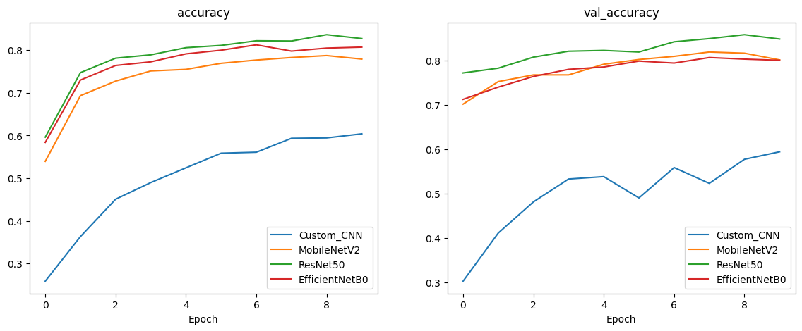
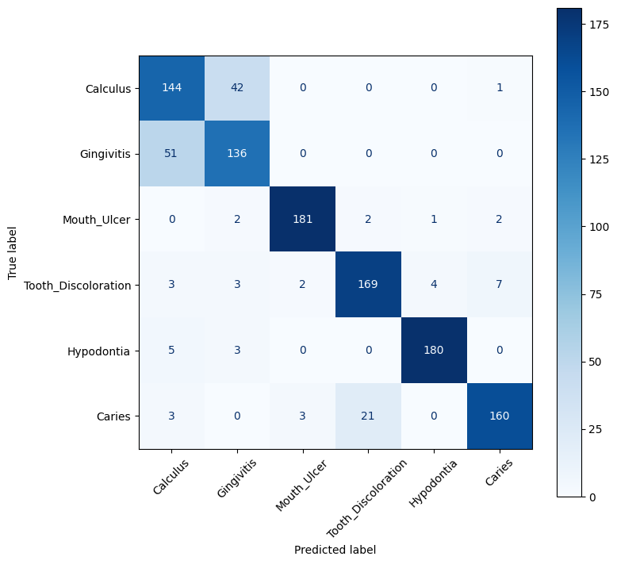

# 🦷 Oral Diseases Image Classification


A deep learning system that classifies oral disease images into **six categories**. The project builds a custom CNN, compares it with three pretrained models, tunes and fine-tunes the best one (**ResNet50**), and deploys it as an interactive **Streamlit** web app.

> ⚠️ **Disclaimer:** This is a student project. It is **not** a medical diagnosis tool.

---

## 🌐 Live Demo

👉 **[Open the Streamlit app](PUT-YOUR-STREAMLIT-LINK-HERE)**

[](PUT-YOUR-STREAMLIT-LINK-HERE)

## 📸 Screenshots




---

## ✨ Features

- Six-class oral disease classification from a single photo
- Four models compared: Custom CNN, MobileNetV2, ResNet50, EfficientNetB0
- Hyperparameter tuning (selected on the validation set) and fine-tuning
- Clean Streamlit UI with confidence score and per-class probability bars

## 🦷 Classes

| Class | Description |
|---|---|
| Calculus | Hardened plaque (tartar) on the teeth |
| Gingivitis | Red, swollen or bleeding gums |
| Mouth Ulcer | Painful sore inside the mouth |
| Tooth Discoloration | Teeth that changed color |
| Hypodontia | One or more teeth missing from birth |
| Caries | Tooth decay that creates cavities |

---

## 📊 Results

### Model comparison (test set)

| Model | Accuracy | Macro F1 | Params (M) |
|---|---|---|---|
| **ResNet50** | **0.8507** | **0.8517** | 23.60 |
| EfficientNetB0 | 0.8249 | 0.8257 | 4.06 |
| MobileNetV2 | 0.7964 | 0.7996 | 2.27 |
| Custom CNN | 0.5893 | 0.5731 | 0.42 |



### Improvement of the best model (ResNet50)

| Stage | Accuracy | Macro F1 |
|---|---|---|
| Default settings | 0.8507 | 0.8517 |
| + Hyperparameter tuning | 0.8551 | 0.8561 |
| + Fine-tuning (last 30 layers) | **0.8622** | **0.8635** |

**Best hyperparameters:** `learning rate = 1e-3`, `batch size = 16`, `dropout = 0.3`

### Per-class performance (final model)

| Class | Precision | Recall | F1-score |
|---|---|---|---|
| Calculus | 0.70 | 0.77 | 0.73 |
| Gingivitis | 0.73 | 0.73 | 0.73 |
| Mouth Ulcer | 0.97 | 0.96 | 0.97 |
| Tooth Discoloration | 0.88 | 0.90 | 0.89 |
| Hypodontia | 0.97 | 0.96 | 0.97 |
| Caries | 0.94 | 0.86 | 0.90 |



**Main findings**
- Mouth Ulcer and Hypodontia are recognized almost perfectly.
- Most errors come from **Calculus ↔ Gingivitis** (visually similar) and **Caries → Tooth Discoloration**.

---

## 🗂️ Dataset

[Oral Diseases on Kaggle](https://www.kaggle.com/datasets/salmansajid05/oral-diseases)

- 1,250 images sampled per class (**7,500** images in total) to keep the classes balanced
- Split: **70% train / 15% validation / 15% test** (stratified)
- Images resized to 224 × 224, with light augmentation on the training set (flip, rotation, zoom)

---

## 🧠 Methodology

1. **Data preparation:** balance the classes, stratified split, resize and augment.
2. **Models:** a custom CNN built from scratch, plus MobileNetV2, ResNet50 and EfficientNetB0 using transfer learning (frozen base, new classification head).
3. **Tuning:** grid search over learning rate, batch size and dropout, selected on **validation accuracy**.
4. **Fine-tuning:** unfreeze the last 30 layers of ResNet50 and train with `lr = 1e-5`.
5. **Evaluation:** accuracy, macro F1, confusion matrix and classification report on the held-out test set.
6. **Deployment:** Streamlit app that loads the saved weights.

---

## 📁 Project structure

```
oral-disease-classification/
├── app.py                  # Streamlit app
├── Oral_Disease.ipynb      # Training, tuning and evaluation notebook
├── best.weights.h5         # Trained ResNet50 weights (Git LFS)
├── class_names.json        # Class labels
├── requirements.txt        # Python dependencies
├── assets/                 # Screenshots and charts for the README
├── LICENSE                 # MIT License
└── README.md
```

---

## 🚀 Run locally

```bash
# 1) Clone the repository
git clone https://github.com/AbdelazizElshourbgy-ui/oral-disease-classification.git
cd oral-disease-classification

# 2) (Recommended) create a virtual environment
python -m venv venv
venv\Scripts\activate        # Windows
# source venv/bin/activate   # macOS / Linux

# 3) Install dependencies
pip install -r requirements.txt

# 4) Start the app
streamlit run app.py
```

Then open `http://localhost:8501`, upload an image, and see the prediction.

> The model weights are stored with **Git LFS**. Install it (`git lfs install`) before cloning so `best.weights.h5` downloads correctly.

---

## ⚠️ Limitations

- The Caries class has only 219 original images; the rest are augmented copies, so near-duplicates may appear in both training and test sets and can inflate that class score.
- The dataset is small (1,250 images per class).
- Calculus and Gingivitis look very similar and are hard to separate.
- Results vary by a few points between runs because of training randomness.

## 🔮 Future work

- Split the original Caries images first, then augment only the training part
- Collect more Calculus and Gingivitis images
- Use a higher resolution and unfreeze more layers
- Add Grad-CAM heatmaps to explain predictions

---

## 🛠️ Tech stack

Python · TensorFlow / Keras · scikit-learn · NumPy · Pandas · Matplotlib · Streamlit · Kaggle

## 👤 Author

**Abdelaziz Elshourbgy**

GitHub: [@AbdelazizElshourbgy-ui](https://github.com/AbdelazizElshourbgy-ui) · LinkedIn: [Abdelaziz Elshourbgy](https://www.linkedin.com/in/abdelaziz-elshourbgy-b126a83a2/)

## 📄 License

Released under the [MIT License](LICENSE).
